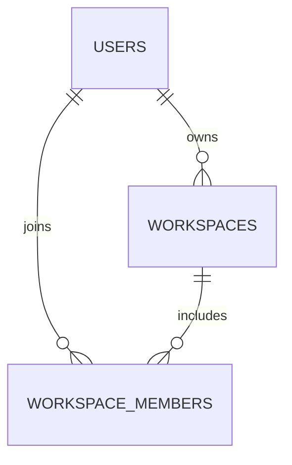

# ForgePM

Jira-style project management portfolio project, built incrementally from the supplied **ForgePM Jira-Style Project Plan**. This release implements the **first authentication sprint**, not the full MVP. The example board on the sign-in page is illustrative.

## Start locally

With Docker and Compose v2, run from the `ForgePM` folder:

```sh
printf 'JWT_SECRET=%s\n' "$(openssl rand -base64 32)" > .env
docker compose up --build
```

Open **http://localhost:8080**, create an account, sign in, and verify that your profile loads. Then sign out. If you already have a `.env`, edit it instead of overwriting it. Compose keeps Postgres data in a named volume; `docker compose down` preserves it, while `docker compose down -v` deletes it.

### Run without Docker

Install Java 17+, Maven 3.9+, Node 22 and PostgreSQL 17. Create a local database `forgepm` owned by `forgepm`; configure its password to match `DATABASE_PASSWORD`. In one shell:

```sh
cd backend
export JWT_SECRET=$(openssl rand -base64 32)
# Set DATABASE_URL, DATABASE_USER and DATABASE_PASSWORD if not using local defaults.
mvn spring-boot:run
```

In a second shell from the project root, `cd frontend && npm ci && npm run dev`. Open **http://localhost:5173**. Vite forwards `/api` to Spring Boot; Compose uses Nginx for the same purpose. No cross-origin browser requests are needed.

## Verify

- Backend: create a **separate disposable** `forgepm_test` database and run `DATABASE_URL=jdbc:postgresql://localhost:5432/forgepm_test mvn verify` from `backend/`. The tests seed synthetic accounts and use their own JWT secret.
- Frontend: run `npm ci && npm run build` from `frontend/`.
- Same-origin smoke test: `python3 scripts/smoke.py http://localhost:5173` with both dev services running, or use `http://localhost:8080` with Compose. This creates one test account in the target database.

## API implemented now

| Method | Path | Request | Success |
|---|---|---|---|
| POST | `/api/v1/auth/register` | `fullName`, `email`, `password` | `201`, profile |
| POST | `/api/v1/auth/login` | `email`, `password` | `200`, `accessToken` and `expiresIn` (seconds) |
| GET | `/api/v1/users/me` | `Authorization: Bearer <token>` | `200`, profile |

Profiles include `id`, `fullName`, and `email`. Passwords require at least 12 characters for registration and cannot exceed 72 UTF-8 bytes (BCrypt limit). Email uniqueness is enforced on normalized lowercase values. Expect `400` for malformed/invalid input, `409` for duplicate registration, and `401` for invalid credentials or missing/invalid authentication.

## Design

`React → Spring MVC controller → auth service → Spring Data repository → PostgreSQL`. Spring Security verifies signed 15-minute JWTs. The UI holds the token in memory; reload signs you out. Sign-out discards the browser token rather than revoking it server-side. The database stores BCrypt hashes only. Flyway owns schema changes and Hibernate validates the schema. Use HTTPS and configure rate limiting, login monitoring and secret management before any public deployment.



Workspace tables are migrated, but workspace and project APIs are not implemented. See [sprint status](follow-ups/01-sprint-status.md), [next sprint](follow-ups/02-workspaces-and-projects.md), and [roadmap](follow-ups/03-roadmap.md).
